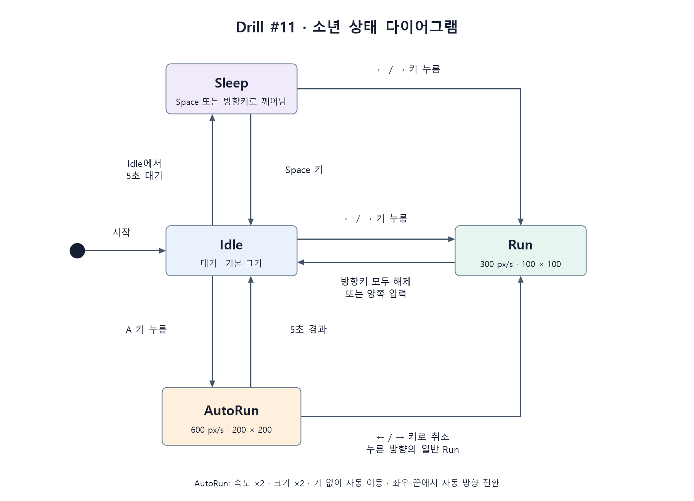

# Drill #11 · 소년 AutoRun

2D 게임프로그래밍 Drill #11 과제. 별도의 `AutoRun` 상태 클래스에서
키 조작 없이 자동 달리기, 확대, 화면 끝 반사와 5초 후 복귀를 구현했다.

기획·요구사항은 [PRD.md](PRD.md)에 정리했다.

## 실행

Python 3.13에서 검증한다. 저장소 폴더에서 다음 명령을 실행한다.

```powershell
python -m pip install -r requirements.txt
python main.py
```

실행 진입점은 `main.py`다. 이미지는 소스 파일 위치를 기준으로 로드하므로
다른 폴더에서 `main.py`의 전체 경로를 지정해 실행해도 된다.

## 조작

| 키 | 동작 |
| --- | --- |
| 왼쪽 / 오른쪽 | 해당 방향으로 일반 달리기 |
| Idle에서 A | AutoRun 시작 |
| AutoRun에서 왼쪽 / 오른쪽 | 자동 달리기를 취소하고 누른 방향의 일반 Run으로 전환 |
| 방향키 해제 또는 양쪽 동시 입력 | 일반 달리기 정지 |
| Space | Sleep에서 Idle로 복귀 |
| Escape / 창 닫기 | 종료 |

Idle 상태에서 5초 대기하면 Sleep으로 전환된다. Sleep에서도 방향키로 달릴 수 있다.

## AutoRun 동작

- Idle에서 `A` 키를 한 번 누르면 바라보는 방향으로 출발한다.
- `A` 키를 놓아도 초당 600픽셀로 계속 이동한다. 일반 Run은 초당 300픽셀이다.
- 그리기 크기가 100 × 100에서 200 × 200픽셀로 커진다.
- 확대된 크기를 기준으로 좌우 끝에서 자동 반사한다.
- 5초가 되면 Idle로 돌아가며, 크기와 속도도 일반 상태의 값으로 복구된다.
- 방향키를 누르면 즉시 해당 방향의 일반 Run으로 바뀐다.
- `A` 키를 길게 눌러도 지속 시간이 늘어나거나 자동 재시작되지 않는다.

## 상태 다이어그램



제출용 PNG와 함께 [Mermaid 원본](docs/state_diagram.mmd),
[PNG 생성 스크립트](tools/render_state_diagram.ps1)를 포함했다.
Windows PowerShell에서 다음 명령으로 PNG를 다시 만들 수 있다.

```powershell
powershell -NoProfile -ExecutionPolicy Bypass -File tools/render_state_diagram.ps1
```

## 검사

```powershell
python -m unittest discover -s tests -v
```

상태 전환, 5초 경계, 속도·확대, 양쪽 반사, 초과 이동량, 키 반복과 방향키 취소를 검사한다.
실제 Pico2D 캔버스에서도 이미지 로딩과 각 상태의 렌더링을 확인한다.

## 파일 구성

```text
main.py                   실행 진입점
boy.py                    소년 데이터, 입력, 상태 전환
states.py                 Idle / Run / Sleep / AutoRun 상태 클래스
settings.py               크기, 속도, 시간 설정
assets/                   실행에 필요한 소년·배경 이미지
docs/state_diagram.png    제출용 상태 다이어그램
PRD.md                    개발 기획·요구사항
tests/test_boy.py         자동 검사
```

이미지는 수업 실습에 제공된 `animation_sheet.png`, `grass.png`를 사용한다.
실행에 필요한 이미지는 모두 `assets/`에 포함되어 있다.

## 제출

이 과제만 포함한 Public 저장소를 사용한다. e-Class에 제출할 주소는
`https://github.com/chanwhee0330/2DGP-Drill11-AutoRun-2023184037.git`이다.
개발 과정은 기획, 기본 제어, AutoRun 구현, 다이어그램·실행 안내 커밋으로 기록한다.
